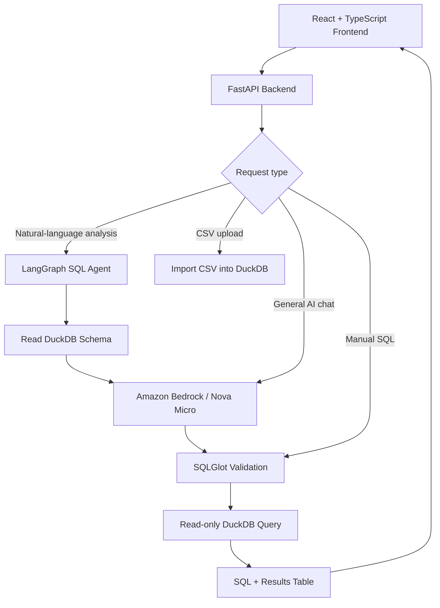

# AgenticSQL 

### AI-Powered Natural Language to SQL Analytics Platform

AgenticSQL is a full-stack AI-powered analytics application that lets users explore CSV datasets by asking questions in plain English. It uses **Amazon Bedrock (Amazon Nova Micro)** to generate SQL, **LangGraph** to orchestrate the query workflow, **SQLGlot** to validate SQL, and **DuckDB** to execute queries locally. Results are displayed in a **React + TypeScript** interface.


---

## ✨ Features

- **Ask questions in natural language:** Generate SQL using the schema of the uploaded dataset.
- **Agentic query workflow:** Use LangGraph to coordinate SQL generation, validation, and execution.
- **CSV upload:** Import a dataset into DuckDB and inspect its columns, types, and row count.
- **SQL analytics workspace:** Write and run validated SQL queries manually.
- **Query transparency:** View generated SQL alongside the results table.
- **AI chat:** Ask general SQL questions through Amazon Bedrock.
- **Local-first development:** Run the database, API, and frontend on your own machine.

### Example: Top five products by quantity sold

**Question:**

> Give me the top 5 sold products.

**Generated SQL:**

```sql
SELECT
    product,
    SUM(quantity) AS total_quantity
FROM sales_data
GROUP BY product
ORDER BY total_quantity DESC
LIMIT 5;
```

**Example output (included sample dataset):**

| Product | Total Quantity |
| :--- | ---: |
| Desk | 352 |
| Monitor | 323 |
| Headphones | 318 |
| Webcam | 288 |
| Office Chair | 286 |

---

##  Architecture



**Agent flow:** Question → schema inspection → SQL generation → SQL validation → DuckDB execution → results.


---

## 🛠️ Tech Stack

| Layer | Technology |
| :--- | :--- |
| Frontend | React, TypeScript, Vite |
| Backend | Python, FastAPI |
| AI platform | Amazon Bedrock |
| Language model | Amazon Nova Micro |
| Agent orchestration | LangGraph |
| SQL database | DuckDB |
| SQL parsing and validation | SQLGlot |
| AWS SDK | Boto3 |
| Version control | Git, GitHub |

---

## 📁 Project Structure

```text
AgenticSQL_project/
├── backend/
│   ├── app/
│   │   ├── api/
│   │   ├── core/
│   │   ├── schemas/
│   │   ├── services/
│   │   └── main.py
│   ├── requirements.txt
│   ├── test_sql_agent.py
│   └── test_sql_generation.py
├── frontend/
│   ├── public/
│   ├── src/
│   │   ├── components/
│   │   ├── services/
│   │   ├── types/
│   │   ├── App.tsx
│   │   └── App.css
│   ├── package.json
│   └── vite.config.ts
├── sample_data/
│   ├── generate_sales.py
│   └── sales.csv
└── README.md
```

---

##  Getting Started

### Prerequisites

- Python 3.10 or newer
- Node.js and npm
- Git
- AWS account with Amazon Bedrock model invocation permissions
- AWS CLI configured with a profile authorized to invoke Amazon Nova Micro

### 1. Clone the repository

```powershell
git clone https://github.com/meghnareddyds/AgenticSQL_project.git
cd AgenticSQL_project
```

### 2. Set up the backend

```powershell
cd backend
python -m venv .venv
.\.venv\Scripts\python.exe -m pip install -r requirements.txt
```

### 3. Configure AWS access

If you have not configured your AWS CLI profile yet:

```powershell
aws configure --profile agenticsql
```

In the terminal where you will start the backend:

```powershell
$env:AWS_PROFILE = "agenticsql"
$env:AWS_DEFAULT_REGION = "us-east-2"
```

**Donot commit AWS credentials, access keys, or `.env` files.** Prefer temporary credentials when available.

### 4. Start FastAPI

From the `backend` directory:

```powershell
.\.venv\Scripts\python.exe -m uvicorn app.main:app --reload
```

- Backend: `http://localhost:8000`
- Interactive API docs: `http://localhost:8000/docs`

### 5. Start the frontend

Open **a second terminal** at the project root:

```powershell
cd frontend
npm install
npm run dev
```

Open the URL shown by Vite (usually `http://localhost:5173`).

### 6. Upload a dataset and ask a question

1. Open **Dataset Management** in the application.
2. Upload `sample_data/sales.csv`.
3. Confirm the detected schema and row count.
4. Select **Analyze Data** and ask: **“Give me the top 5 sold products.”**
5. Inspect the generated SQL and returned results.

---

## 💬 Questions to Try

- What are the top five products by quantity sold?
- Which region generated the highest revenue?
- What is the total revenue?
- How many orders are in the dataset?
- What is the average order value?
- Which category generates the most revenue?

---

## 🔌 API Endpoints

| Method | Endpoint | Purpose |
| :--- | :--- | :--- |
| `GET` | `/health` | Backend health check |
| `GET` | `/api/schema` | Get the active dataset schema |
| `POST` | `/api/upload` | Upload a CSV file |
| `POST` | `/api/query` | Validate and execute a SQL query |
| `POST` | `/api/chat` | General AI chat through Bedrock |
| `POST` | `/api/agent/query` | Natural-language-to-SQL agent workflow |

Explore request and response formats at `http://localhost:8000/docs` while the backend is running.

---

## 🧪 Testing and Build

From the **project root**, run the existing integration scripts:

```powershell
.\backend\.venv\Scripts\python.exe backend\test_sql_generation.py
.\backend\.venv\Scripts\python.exe backend\test_sql_agent.py
```

Verify the frontend production build:

```powershell
cd frontend
npm run build
```

> The agent tests may invoke Amazon Bedrock and incur usage-based charges.

---

## 🗺️ Roadmap

### Completed

- [x] FastAPI backend and React + TypeScript frontend
- [x] DuckDB integration and CSV upload
- [x] Dataset schema inspection
- [x] SQL validation using SQLGlot
- [x] Amazon Bedrock and Nova Micro integration
- [x] LangGraph SQL agent
- [x] Natural-language-to-SQL execution
- [x] SQL and results displayed in the web interface

### Planned

-  Interactive charts and visualizations
-  ChromaDB semantic retrieval
-  Improved query explanations and insights

---

## Security and AWS Costs

AgenticSQL is a **local development prototype**. Its SQL safeguards are not a substitute for authentication, query resource limits, rate limiting, and deployment isolation in a public environment.

Amazon Bedrock model inference is usage-based. Monitor AWS Billing and Cost Management, avoid unnecessary test calls, and keep credentials outside source control.

---

## 🎯 Project Goal

AgenticSQL demonstrates how generative AI, agent orchestration, and relational databases can work together to make analytics accessible through natural-language questions.

---

## 👩‍💻 Author

**Meghna Reddy** · GitHub: **meghnareddyds**

